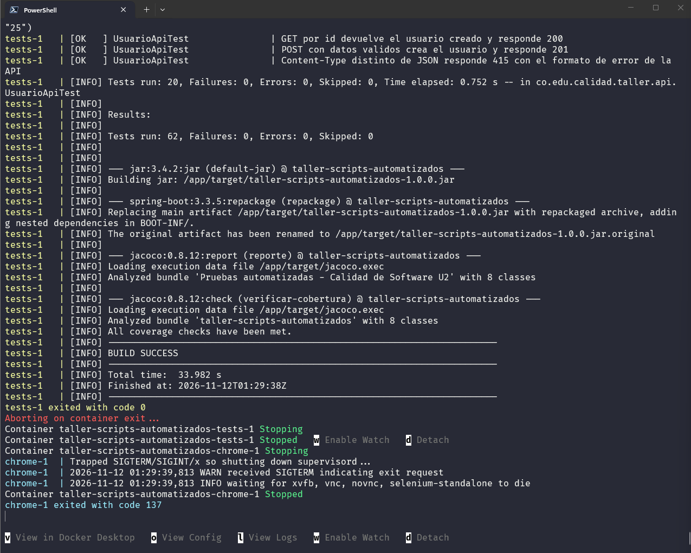
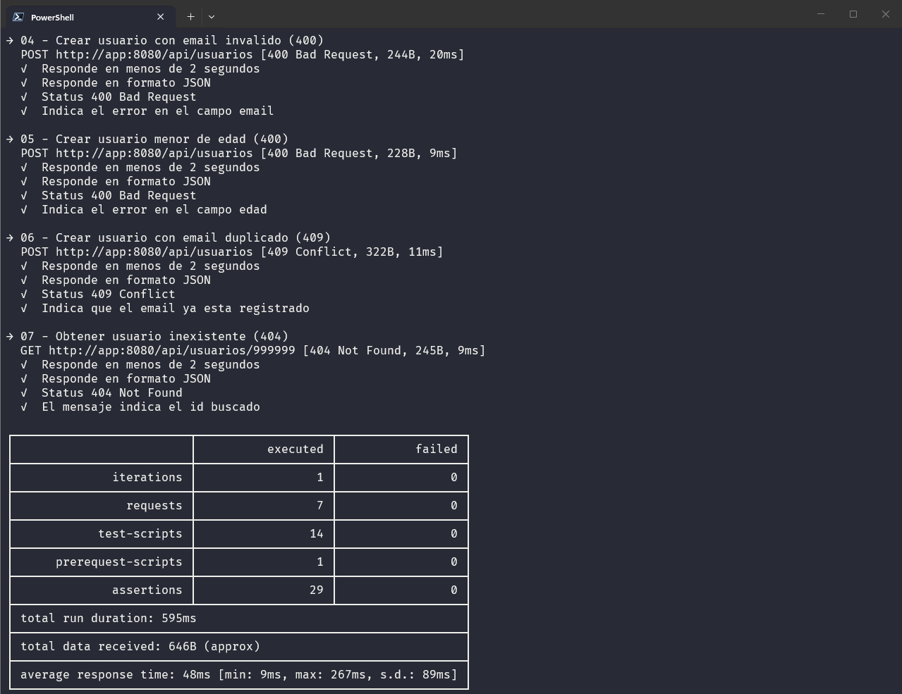
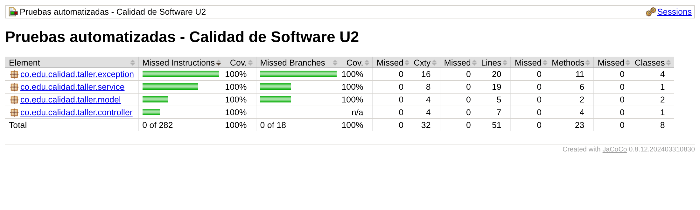
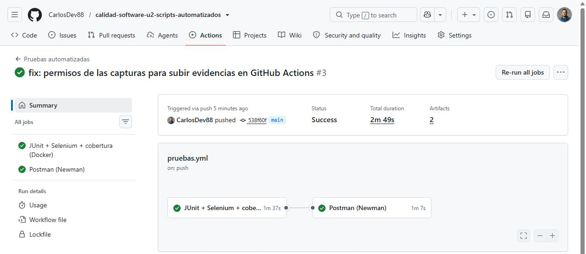
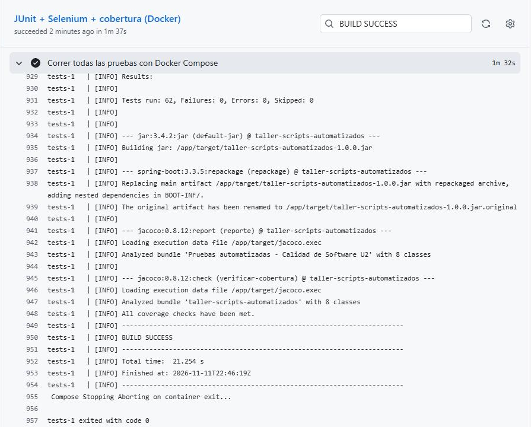
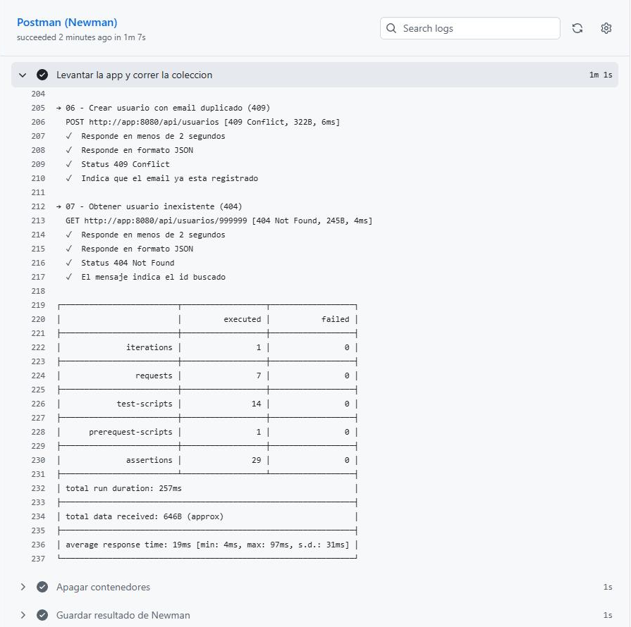

# Guía paso a paso del proceso de automatización

La guía tiene dos partes:

- **Parte A**: cómo se construyó la suite y por qué se tomó cada decisión.
- **Parte B**: cómo ejecutarla.

Las capturas están en `evidencias/capturas-proceso/`.

---

## Parte A. Cómo se construyó

### A1. Definir qué se va a probar

La aplicación bajo prueba es un registro de usuarios con dos entradas:

- **API REST** `/api/usuarios`: crear, listar y buscar.
- **Formulario web** `registro.html`: envía los datos a la API y muestra los errores debajo de cada campo.

Primero se escribieron las reglas, porque de ellas salen los casos de prueba:

| Regla | Válido | Inválido |
|---|---|---|
| Nombre (se recortan espacios antes de validar) | 3 a 60 caracteres | vacío, solo espacios, 2 o 61 caracteres, `"  A  "` |
| Email | formato `usuario@dominio.ext` y único | sin `@`, sin dominio, repetido |
| Edad | número entero de 18 a 100 | vacía, negativa, 17, 101, decimal (`18.9`), texto (`"25"`) |

**Decisión:** se construyó una aplicación propia en lugar de probar una página pública. Una página externa puede cambiar o caerse, y entonces la prueba falla sin que haya un error real. Con una app propia las reglas son conocidas y los resultados se pueden repetir.

### A2. Elegir herramientas por nivel (y qué se descartó)

Se siguió la **pirámide de pruebas**: muchas pruebas unitarias rápidas, menos de integración y pocas de interfaz, porque estas son las más lentas.

| Necesidad | Elegida | Alternativa considerada | Por qué la elegida |
|---|---|---|---|
| Pruebas unitarias | JUnit 5 + Mockito | TestNG | JUnit 5 ya viene con Spring Boot y tiene `@ParameterizedTest` y `@Nested`, que se usaron mucho. |
| API desde Java | TestRestTemplate | REST Assured | Viene incluido en Spring Boot y ya se había usado en el AA1; REST Assured tiene una sintaxis más legible, pero suma una dependencia. |
| API desde fuera | Postman + Newman | Insomnia | Postman lo pide la actividad, y Newman permite correr la misma colección en consola y en CI. |
| Interfaz | Selenium WebDriver | Playwright, Cypress | Lo pide la actividad. Playwright espera los elementos de forma automática y suele ser más rápido; con Selenium hubo que programar esperas explícitas. |
| Cobertura | JaCoCo, mínimo 80 % | Sin mínimo | 80 % es un umbral común: obliga a probar casi todo sin exigir el 100 % en cada clase nueva. |
| CI | GitHub Actions | Jenkins, GitLab CI | El código ya está en GitHub y no hace falta montar un servidor. |

### A3. Pruebas unitarias (`src/test/java/.../unit/`)

1. **`UsuarioServiceTest`**: crea el servicio con `new`, sin Spring. Usa `@Nested` para agrupar por comportamiento.
2. **`UsuarioRequestValidacionTest`**: aplica dos técnicas de caja negra de la Unidad 1:
   - **Valores límite**: edad 17/18/100/101; nombre de 2/3/60/61 caracteres.
   - **Particiones de equivalencia**: emails válidos e inválidos, edad negativa, nombre vacío o solo con espacios.
3. **`UsuarioControllerTest`**: `@WebMvcTest` levanta solo la capa web y el servicio se reemplaza por un mock de Mockito. Con datos inválidos se verifica que el controlador **nunca** llama al servicio: `verify(servicio, never()).crear(any())`.

### A4. Pruebas de API

- **TestRestTemplate** (`api/UsuarioApiTest`): levanta la app real en un puerto aleatorio y cubre:
  - 201 creado y 200 lista/consulta.
  - 404 no existe.
  - 400 en datos inválidos (parametrizado).
  - 400 con edad decimal o como texto.
  - 405 y 415 con el formato de error de la API.
  - 409 email duplicado.
  - 400 con JSON roto.
- **Postman**: siete peticiones en orden. La primera guarda el id en una variable que usan las siguientes. Una prueba común a toda la colección verifica tiempo menor a 2 s y respuesta JSON.

### A5. Pruebas del formulario (Selenium)

- **Page Object** (`web/pages/RegistroPage`): localizadores y acciones en una sola clase.
- **Esperas explícitas** (`WebDriverWait`) en lugar de `Thread.sleep`.
- **Capturas automáticas**: datos de entrada y resultado por caso. Si una prueba falla, `CapturaEnFallo` guarda la pantalla antes de cerrar el navegador.
- **`DriverFactory`**: usa el Chrome del contenedor (`SELENIUM_REMOTE_URL`) o un Chrome local, sin cambiar las pruebas.

### A6. Cobertura y CI

- `mvn verify` genera el reporte JaCoCo y **falla si la cobertura de líneas baja del 80 %**.
- `.github/workflows/pruebas.yml` corre JUnit/Selenium y luego Postman en cada push a `main`.

### A7. Dificultades encontradas y cómo se resolvieron

| Problema | Causa | Solución |
|---|---|---|
| Un mismo dato inválido devolvía a veces un mensaje y a veces otro | `""` falla dos reglas a la vez (`@NotBlank` y `@Size`) y Spring no garantiza el orden | En `ManejadorErrores` el mensaje de "obligatorio" tiene prioridad |
| La imagen `postman/newman:6.2.1-alpine` no existía en Docker Hub | Se asumió una etiqueta sin verificarla | Se cambió a `6.1.3-alpine`, la 6.x más reciente publicada |
| Las primeras conexiones a Selenium fallaban de vez en cuando | El contenedor de Chrome tarda unos segundos en estar listo | `DriverFactory` reintenta la conexión hasta 10 veces |
| Fuera de Docker, Chrome no abría | La versión de ChromeDriver no coincidía con la de Chrome | Variables `CHROME_BIN` y `CHROMEDRIVER_PATH` en `DriverFactory` |
| **Defecto real**: `"  A  "` se aceptaba y se guardaba como `"A"` | El servicio recortaba espacios **después** de validar | Pruebas nuevas en rojo y luego recorte en `UsuarioRequest` **antes** de validar |
| **Defecto real**: edad `18.9` se guardaba como `18` y `"25"` (texto) se aceptaba | Jackson convierte tipos en silencio | `accept-float-as-int=false` y `allow-coercion-of-scalars=false` |
| **Defecto real**: 405 y 415 respondían con otro formato JSON | Solo se manejaban 400, 404 y 409 | Manejadores nuevos en `ManejadorErrores` |

Los tres defectos aparecieron en una revisión posterior de la API, con casos que no estaban en la suite. Primero se escribieron las pruebas que los reproducen: 8 fallaron, como muestra `evidencias/defectos-antes-de-corregir.txt`. Después se corrigió el código y la suite volvió a verde.

---

## Parte B. Cómo ejecutarlo

### B1. Requisitos

Docker Desktop encendido. No hace falta instalar Java, Maven ni Chrome.

```powershell
git clone https://github.com/CarlosDev88/calidad-software-u2-scripts-automatizados.git
cd calidad-software-u2-scripts-automatizados
docker version
```

### B2. Correr todas las pruebas JUnit (unitarias, API y Selenium) con cobertura

```powershell
docker compose up --build --exit-code-from tests
```

Así termina el comando en PowerShell, en el equipo donde se generaron las evidencias:



Mientras corre, el navegador se ve en vivo en http://localhost:7900 (clave `secret`).

### B3. Correr solo una parte

```powershell
docker compose run --rm tests mvn -B test "-Dgroups=unit" "-Djacoco.skip=true"   # solo unitarias (en PowerShell las comillas son necesarias)
```

Las otras etiquetas son `api` y `ui`.

### B4. Correr la colección Postman

```powershell
docker compose --profile postman run --rm newman
docker compose --profile demo --profile postman down
```



### B5. Revisar la cobertura

Abrir `evidencias/cobertura/html/index.html` en el navegador.



### B6. Integración continua

Al hacer push a `main`, la pestaña **Actions** del repositorio muestra la ejecución.



El primer trabajo corre el mismo comando de B2 y el segundo la colección Postman de B4:





### B7. Evidencias generadas

| Archivo | Contenido |
|---|---|
| `resultados-pruebas.txt` | Cada prueba con OK o FALLO |
| `salida-consola.txt` | Salida de `mvn verify` |
| `surefire-reports/` | Reportes JUnit con tiempos |
| `cobertura/` | Cobertura JaCoCo (reporte HTML en `cobertura/html/index.html`) |
| `capturas/` | Capturas de Selenium |
| `newman-resultados.xml` | Resultado de Newman |
| `defectos-antes-de-corregir.txt` | Pruebas en rojo antes de corregir los defectos |
